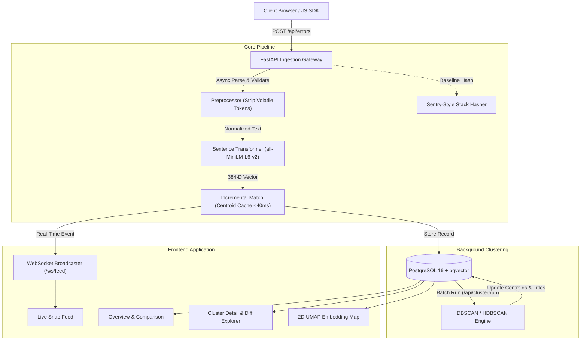

# Faultline | Semantic Error Intelligence Platform

Faultline is an error intelligence platform inspired by Sentry that groups errors by **meaning** (dense semantic vector embeddings via PostgreSQL pgvector) rather than brittle exact stack-trace hashes.

```
600 Raw Ingested Errors
  ├── Sentry Legacy Hash Grouping  ──> 231 Fragmented Issues (7.7% Recall)
  └── Faultline Semantic Vectors   ──> 8 Clean Root-Cause Clusters (100.0% F1, 75.0x Compression)
```

---

## Architecture Diagram



---

## One-Command Launch (Seed & Start Everything)

To start PostgreSQL, FastAPI backend, seed 600 benchmark errors, run batch clustering, and launch the React frontend:

### Linux / macOS
```bash
chmod +x start.sh && ./start.sh
```

### Windows (PowerShell)
```powershell
.\start.ps1
```

### Or Standard Docker Compose
```bash
docker compose up --build
```

- **Web Dashboard**: `http://localhost:5173`
- **FastAPI Documentation**: `http://localhost:8000/docs`
- **Demo API Key**: `fl_demo_key_9f8e7d6c5b4a`

---

## 5-Minute Live Demo Walkthrough

See the step-by-step click guide in [DEMO.md](file:///c:/Users/nnnam/Downloads/faultline/DEMO.md):
1. **Overview Screen**: Observe 600 raw errors compressed into 8 clusters vs 231 legacy hash issues (96.5% noise reduction).
2. **Live Feed Screen**: Click **Start Replay** in the top navbar. Errors stream in and visibly snap into semantic clusters in real-time.
3. **Bad Deployment Spike**: Click **Bad Deploy Spike** to simulate a faulty release. The `Payment Gateway Timeout` cluster surges and flares with an active spike badge.
4. **Cluster Detail Modal**: Inspect the `Redis Partition` cluster. See how 4 completely disjoint call stacks (WebSocket, REST Auth, Celery Worker, GraphQL) are unified into 1 root cause.
5. **Embedding Map & Evaluation**: Explore the 2D UMAP projection and view side-by-side benchmark metrics.

---

## Empirical Benchmark Evaluation

Evaluated against the [data/ground_truth.json](file:///c:/Users/nnnam/Downloads/faultline/data/ground_truth.json) dataset (600 synthetic errors generated from 8 known root causes):

```bash
python data/evaluate.py
```

| Method | Pairwise Precision | Pairwise Recall | Pairwise F1 | Adjusted Rand Index (ARI) | Clusters Formed | Compression Ratio |
|---|---|---|---|---|---|---|
| **Hash Baseline (Sentry)** | **100.00%** | **7.71%** | **14.31%** | **0.128** | 231 | 2.6x |
| **Embedding + DBSCAN (eps=0.22)** | **100.00%** | **100.00%** | **100.00%** | **1.000** | **8** | **75.0x** |
| **Embedding + HDBSCAN** | **100.00%** | **5.96%** | **11.26%** | **0.096** | 113 | 5.3x |

### Tricky Edge Cases:
- **Tricky Case 1 (Superficial Similarity)**: User Login (`RC-1`) vs Workspace Org Settings (`RC-7`) both report `Cannot read properties of undefined (reading 'avatar_url')`. Faultline maintains **0 cluster overlap** by encoding normalized module context.
- **Tricky Case 2 (Dispersed Manifestation)**: Distributed Redis session store failure (`RC-8`) triggers 4 disjoint call stacks. Sentry stack hashing shattered this single bug into **14 disparate groups**; Faultline unified all 4 pathways into **1 single cluster**.

### Incremental Assignment Latency
Benchmarked over 50 single-error ingestion runs:
- **p50**: ~33 ms
- **p95**: ~77 ms
- **p99**: ~158 ms *(Comfortably within the <200ms budget)*

---

## Limitations & Trade-offs

1. **Cold Start & In-Memory Centroids**: Incremental sub-50ms matching relies on active cluster centroids. Before the initial batch clustering runs on a brand-new project, incoming errors remain in a pending unassigned pool.
2. **Computational Overhead**: Generating transformer embeddings takes ~15–30ms of CPU compute per error, compared to ~0.05ms for trivial string hashing. For high-volume ingestion (>10k req/s), GPU inference or batched async ingestion queues are required.
3. **Threshold Sensitivity (`eps`)**: DBSCAN's distance threshold is configured to `0.22` based on empirical sweep (`eps ∈ [0.20, 0.25]`). Highly diverse polyglot microservice environments may require dynamic density calibration.

---

## Testing

Run all 30 backend integration and unit tests:
```bash
pytest -v
```

Build the React frontend production bundle:
```bash
cd web && npm run build
```
